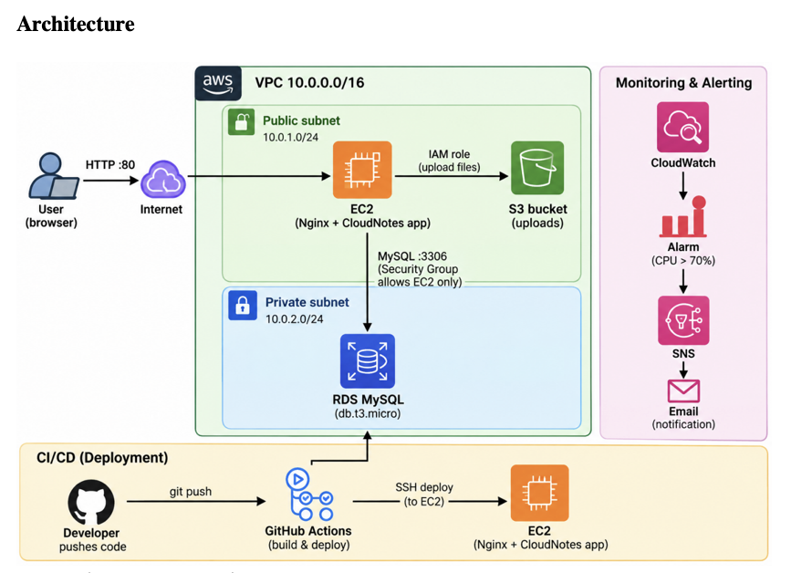

# AWS Web Application Architecture — DevNotes

## 1. Project Overview

DevNotes is a web application deployed on AWS. The infrastructure separates the application server, database, backup storage, access control, and monitoring so that each component has a clear responsibility.

This document summarizes the AWS architecture and implementation captured in 

[`AWS_WebApp_Architecture_implementation.pdf`](./docs/AWS_WebApp_Architecture_implementation.pdf).

## 2. Architecture at a Glance

```text
                         Users / Web Browser
                                  |
                               HTTP :80
                                  |
                              Internet
                                  |
                         Internet Gateway
                                  |
                       Public subnet / VPC
                                  |
                    EC2: DevNotes-Web-Server
                         Amazon Linux 2023
                                  |
                         Nginx reverse proxy
                                  |
                       Dockerized application
                         /              \
                 React frontend      FastAPI backend
                                          |
                                     MySQL :3306
                                          |
                               Amazon RDS: database-1
                               (private, not public)

        EC2 backup process --------------------> Amazon S3
                                                  backups/
                                                  ├── devnotes-20261022-110717.db
                                                  └── devnotes-20261022-111030.db

        EC2 CPU metrics ---> Amazon CloudWatch alarm ---> Amazon SNS email
                              CPUUtilization > 70%       confirmed subscription

        IAM role: DevNotes-EC2-S3-Role
        provides permitted AWS access to the EC2 instance

        GitHub repository / GitHub Actions CI and Jenkins pipeline
        are documented separately from the AWS runtime architecture.
```

> **Architecture note:** The PDF confirms the named AWS resources and the intended traffic paths, but not every route-table rule or every runtime connection in a single screenshot. Verify live AWS settings before treating this diagram as a current-state network audit.

## 3. AWS Region and Network

- **Region:** Asia Pacific (Mumbai), `ap-south-1`
- **VPC:** `DevNotes-VPC-vpc`
- **VPC ID:** `vpc-0f132930898a5967e`
- **Internet Gateway:** `DevNotes-IGW`
- **Web security group:** `DevNotes-Web-SG`
- **Database security group:** `DevNotes-DB-SG`

The VPC provides a logically isolated network for project resources. The PDF documents a public subnet and two private subnets, as well as separate route tables for private subnets.

An Internet Gateway is attached to the VPC. A subnet is only effectively public when its route table sends internet-bound traffic to the Internet Gateway and the instance has appropriate public addressing and security rules. The subnet and route-table list screenshots alone do not prove every route association.

### Security group rules documented

| Security group | Protocol / port | Source | Purpose |
|---|---|---|---|
| `DevNotes-Web-SG` | HTTP / TCP 80 | `0.0.0.0/0` | Allows public HTTP access to the web application |
| `DevNotes-Web-SG` | SSH / TCP 22 | A single IPv4 `/32` address in the PDF | Restricts SSH to one source address |
| `DevNotes-DB-SG` | MySQL / TCP 3306 | Intended source: `DevNotes-Web-SG` | Allows the app server to reach the database |

Keep SSH restricted to a trusted IP. Do not expose MySQL port 3306 to the public internet.

## 4. Application Server — Amazon EC2

The PDF documents an EC2 instance named `DevNotes-Web-Server`.

| Property | Documented value |
|---|---|
| Instance type | `t3.micro` |
| Operating system | Amazon Linux 2023 |
| Availability Zone | `ap-south-1a` |
| Instance ID | `i-0949f90cacaef480b` |
| Web server | Nginx |
| SSH user | `ec2-user` |

Nginx was installed and enabled as a system service. The documented commands were:

```bash
sudo dnf update -y
sudo dnf install nginx -y
sudo systemctl enable --now nginx
sudo systemctl status nginx
```

The project subsequently ran the frontend and backend as Docker containers on the server. The evidence shows Nginx running, but an Nginx service check by itself does not prove that the complete application and API are healthy.

## 5. Database — Amazon RDS for MySQL

The application backend was configured to use Amazon RDS instead of relying solely on its local SQLite database.

| Property | Documented value |
|---|---|
| DB identifier | `database-1` |
| Engine | MySQL Community |
| Instance class | `db.t4g.micro` |
| Region / Availability Zone | `ap-south-1` / `ap-south-1b` |
| Port | `3306` |
| Publicly accessible | No |
| Security group | `DevNotes-DB-SG` |
| Database endpoint | `database-1.cluugk4m820m.ap-south-1.rds.amazonaws.com` |

The database is intended to remain private inside the VPC. The EC2 application server connects to RDS through the VPC network, and the database security group should permit MySQL only from the web-server security group.

**Credential safety:** Do not place database passwords, `.env` contents, private keys, or AWS access keys in this Markdown file or in the public repository.

## 6. Backup Storage — Amazon S3

The project S3 bucket is:

`devnotes-attachments-607252889349`

The PDF documents two files in the `backups/` prefix:

- `devnotes-20261022-110717.db`
- `devnotes-20261022-111030.db`

Each was approximately 12 KB, stored in S3 Standard. The PDF also records that one downloaded SQLite file passed a SQLite integrity check.

**Important limitation:** These `.db` files are SQLite backups. Since the backend was migrated to MySQL on RDS, these files must **not** be described as verified backups of the latest RDS database. A separate, tested MySQL/RDS backup process is required to protect current production data.

The EC2 role `DevNotes-EC2-S3-Role` is intended to grant the instance permitted access to the project bucket without storing long-term AWS access keys on the server. The role includes the inline policies `DevNotes-S3-Access` and `DevNotes-EC2-DescribeInstances`; review their JSON and resource scope in IAM before relying on them.

## 7. Monitoring and Alerts — CloudWatch and SNS

### CloudWatch alarm

The documented alarm is `DevNotes-High-CPU-Alarm`.

| Setting | Value |
|---|---|
| Namespace | `AWS/EC2` |
| Metric | `CPUUtilization` |
| Statistic | Average |
| Threshold | Greater than 70% |
| Period | 5 minutes |
| Datapoints to alarm | 1 out of 1 |
| Alarm actions | Enabled |

The screenshots show different states at different capture times, including **OK** and **Insufficient data**. These are time-specific observations, not contradictory configuration claims. `Insufficient data` means CloudWatch could not evaluate the alarm from available datapoints at that time.

### SNS notification topic

- **Topic:** `fahim-project2-alerts`
- **Type:** Standard
- **Region:** `ap-south-1`
- **Email subscription:** Confirmed in the  PDF

The SNS topic is configured as the notification destination for alarm actions. A confirmed subscription indicates that the endpoint subscription was confirmed; it does not, by itself, prove that a particular alarm email was delivered. A test alarm or controlled CPU test would provide stronger end-to-end confirmation.

## 8. Identity and Access Management (IAM)

The project documentation covers:

- Root-user MFA configured; no root access keys were listed in the captured screenshot.
- IAM group `developers` with the AWS-managed `AmazonEC2ReadOnlyAccess` policy.
- EC2 role `DevNotes-EC2-S3-Role`, trusted by the EC2 service.
- Inline policies named `DevNotes-S3-Access` and `DevNotes-EC2-DescribeInstances`.

The intended security model is to use IAM identities and roles with limited permissions instead of sharing root credentials or storing long-term access keys on the EC2 host. Verify each policy's actual actions and resource ARNs before claiming least-privilege enforcement.

## 9. Cost Monitoring — AWS Budgets

The PDF documents a monthly budget named `DevNotes-Monthly-Budget` with a `$1.00` amount and alert thresholds for actual and forecast spending.

AWS Budgets is a **notification mechanism**, not a hard spending cap. It does not automatically stop EC2, RDS, or other resources when a threshold is exceeded. Check the current billing console and remove unused resources to control costs.

## 10. How the Components Work Together

1. A user opens the DevNotes website over HTTP.
2. Traffic reaches the EC2-hosted Nginx web server through the configured public networking path.
3. Nginx serves the frontend and routes applicable API requests to the backend container.
4. The backend reads and writes application data in the private Amazon RDS MySQL database.
5. The backup process stores backup files in the S3 bucket using the EC2 instance role's permitted access.
6. CloudWatch monitors EC2 CPU utilization.
7. When the alarm condition is met, the configured alarm action can publish a notification through SNS to the confirmed email subscription.
8. IAM policies control which AWS operations the project identities and EC2 role can perform.
9. AWS Budgets sends cost notifications according to its configured thresholds.

The CI/CD tools are a related but distinct part of the development workflow. GitHub Actions checks the backend and frontend Docker builds on pushes and pull requests to `main`. Jenkins is configured through a separate pipeline. Do not claim that either workflow automatically deploys to EC2 unless the deployment stage and its successful execution are verified.

## 11. Validation Checklist

Before describing the deployment as fully operational, verify:

- [ ] The public application page loads.
- [ ] The application API health endpoint returns a successful response.
- [ ] Creating a note persists it in RDS and it remains after an application restart.
- [ ] The RDS instance is not publicly accessible.
- [ ] `DevNotes-DB-SG` permits port 3306 only from the intended application security group.
- [ ] The EC2 role's S3 policy is limited to the required bucket and actions.
- [ ] A recent backup of the **current RDS/MySQL data** exists and has been tested for restoration.
- [ ] The CloudWatch alarm is receiving metrics and its SNS action is correctly configured.
- [ ] Unused billable AWS resources have been removed after evidence collection.

## 12. Related Files

- [AWS infrastructure implementation screenshots (PDF)](./docs/AWS_WebApp_Architecture_implementation.pdf)
- [Project source repository](https://github.com/rehmnjr/DevNotes)

The PDF contains the screenshot for IAM, VPC, EC2, S3, CloudWatch, SNS, AWS Budgets, and RDS. Refer to the PDF for the individual configuration screenshots and their capture-time notes.

---
