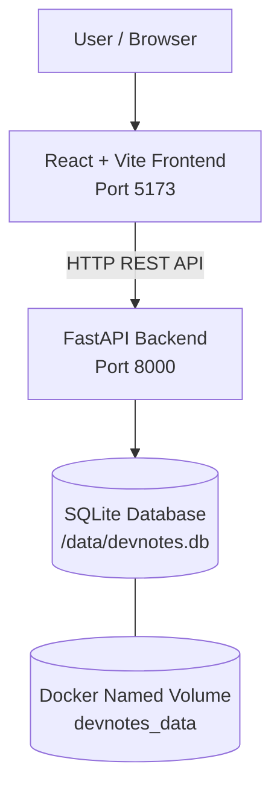

# DevNotes — Full-Stack Notes Application

<p align="center">
  <strong>A clean, containerized workspace for capturing, organizing, and managing notes.</strong>
</p>

<p align="center">
  <a href="#overview">Overview</a> ·
  <a href="#features">Features</a> ·
  <a href="#architecture">Architecture</a> ·
  <a href="#installation">Installation</a> ·
  <a href="#troubleshooting">Troubleshooting</a> ·
  <a href="#roadmap">Roadmap</a>
</p>

<p align="center">
  
  
  
  
  
  
</p>

---

## Overview

**DevNotes** is a full-stack note-taking application built with React and FastAPI. It provides a simple interface for creating, viewing, editing, searching, categorizing, and deleting notes.

The project also serves as a hands-on DevOps learning project. The application has been containerized using Docker, and Docker Compose is configured to manage the frontend and backend together. A named Docker volume is configured to persist the SQLite database beyond the lifecycle of the backend container.

The next development milestone is to automate the build and deployment workflow with Jenkins and deploy the application to AWS.

### Project goals

- Build a working full-stack application with a separate frontend and backend.
- Implement REST API endpoints for note management.
- Containerize application components using Docker.
- Orchestrate multiple services using Docker Compose.
- Configure persistent storage for SQLite.
- Learn Git-based version control and prepare the project for GitHub.
- Extend the project with CI/CD automation and cloud deployment.

## Problem Statement

Notes, code snippets, and small pieces of technical information can become difficult to manage when scattered across files, applications, or temporary documents.

DevNotes addresses this problem by providing a centralized interface where users can organize notes, search existing content, and update or remove information when needed.

The project also addresses a second engineering challenge: making a local full-stack application easier to reproduce and operate through containerization.

## Features

| Feature | Description |
|---|---|
| Create notes | Add a title, content, and category. |
| View notes | Retrieve and display saved notes. |
| Update notes | Edit existing note information. |
| Delete notes | Remove notes through the API and interface. |
| Search | Find notes through the frontend search functionality. |
| Categories | Organize notes by category. |
| Code-related notes | Store notes marked as code-related. |
| Pinning data model | Includes an `is_pinned` database field and pin-based ordering in the API. |
| REST API | FastAPI endpoints for note operations. |
| Dockerized backend | Runs the API in a Python container. |
| Dockerized frontend | Runs the React/Vite development server in a Node.js container. |
| Docker Compose | Builds and manages the frontend and backend services together. |
| Persistent database configuration | Uses a named Docker volume for the SQLite database. |
| Health endpoint | Provides a basic backend health check. |

> **Implementation note:** The pinning field and API ordering are implemented in the backend. Full pin/unpin functionality in the frontend remains a future improvement.

## Technology Stack

### Frontend

- **React** — component-based user interface.
- **Vite** — frontend development server and build tooling.
- **CSS** — responsive application styling.
- **Lucide React** — interface icons.

### Backend

- **Python** — backend programming language.
- **FastAPI** — REST API framework.
- **SQLAlchemy** — database models and ORM.
- **Pydantic** — request validation.
- **SQLite** — lightweight relational database.
- **Uvicorn** — ASGI server.

### DevOps and tooling

- **Git** — source control.
- **Docker** — application containerization.
- **Docker Compose** — multi-container orchestration.
- **Jenkins** — planned CI/CD automation.
- **AWS EC2** — planned cloud hosting and deployment target.

## Architecture

The application follows a simple frontend/backend architecture.



### Component responsibilities

**Frontend**
- Renders the note management interface.
- Handles user input, search, and editing.
- Sends HTTP requests to the backend.

**Backend**
- Validates incoming requests.
- Performs create, read, update, and delete operations.
- Communicates with SQLite through SQLAlchemy.
- Exposes a health-check endpoint.

**Database**
- Stores notes and their associated fields.
- Uses a file-based SQLite database.

**Docker Compose**
- Builds the application images.
- Runs both services.
- Configures service ports and startup dependencies.
- Mounts persistent storage for the database.

## Project Structure

```text
DevNotes/
├── backend/
│   ├── Dockerfile
│   ├── requirements.txt
│   └── main.py
│
├── frontend/
│   ├── Dockerfile
│   ├── package.json
│   ├── package-lock.json
│   └── src/
│       ├── App.jsx
│       ├── App.css
│       └── index.css
│
├── docker-compose.yml
├── .gitignore
└── README.md
```

*The frontend directory may contain additional files, components, and configuration files not shown above.*

## API Documentation

Base URL: `http://localhost:8000`

FastAPI provides interactive documentation at `/docs`.

| Method | Endpoint | Purpose |
|---|---|---|
| GET | `/` | Returns a welcome message and service status. |
| GET | `/health` | Checks backend health. |
| POST | `/notes` | Creates a note. |
| GET | `/notes` | Retrieves notes. |
| PUT | `/notes/{note_id}` | Updates an existing note. |
| DELETE | `/notes/{note_id}` | Deletes a note. |

### Example: Create a note

Request:

```http
POST /notes
Content-Type: application/json
```

```json
{
  "title": "Docker Basics",
  "content": "Learn images, containers, volumes, and networks.",
  "category": "DevOps",
  "is_code": false
}
```

### Example: Health check

```http
GET /health
```

Expected response:

```json
{
  "status": "healthy"
}
```

### Note data model

Each note includes:

| Field | Type | Description |
|---|---|---|
| `id` | Integer | Primary key. |
| `title` | String | Note title; required. |
| `content` | Text | Note content. |
| `category` | String | Category label. |
| `is_code` | Boolean | Indicates a code-related note. |
| `is_pinned` | Boolean | Stores pin status. |

## Getting Started

### Prerequisites

Install the following tools:

- Git
- Docker Desktop
- Docker Compose v2
- Node.js and npm for local frontend development
- Python for local backend development

Verify Docker:

```bash
docker --version
docker compose version
docker info
```

### Option 1: Run the complete application using Docker Compose

Clone the repository after it has been published to GitHub:

```bash
git clone https://github.com/YOUR-USERNAME/DevNotes.git
cd DevNotes
```

Build and start the services:

```bash
docker compose up --build
```

Open the application:

| Service | URL |
|---|---|
| Frontend | http://localhost:5173 |
| Backend | http://localhost:8000 |
| API documentation | http://localhost:8000/docs |
| Health check | http://localhost:8000/health |

To stop the services, press `Ctrl + C` in the foreground terminal.

Alternatively, run the services in detached mode:

```bash
docker compose up --build -d
```

View running services:

```bash
docker compose ps
```

View logs:

```bash
docker compose logs -f
```

Stop and remove the containers and Compose network:

```bash
docker compose down
```

The named database volume is retained by this command. Avoid `docker compose down -v` unless you intentionally want to remove the volume and its database data.

### Option 2: Run the backend locally

```bash
cd backend
python -m venv venv
source venv/bin/activate
pip install -r requirements.txt
python -m uvicorn main:app --reload
```

The API will be available at `http://localhost:8000`.

### Option 3: Run the frontend locally

In a separate terminal:

```bash
cd frontend
npm install
npm run dev
```

The frontend will be available at `http://localhost:5173`.

The backend must be running separately for API operations to work.

## Docker Configuration

### Backend Dockerfile

The backend uses a lightweight Python image.

```dockerfile
FROM python:3.12-slim

WORKDIR /app

ENV PYTHONDONTWRITEBYTECODE=1
ENV PYTHONUNBUFFERED=1

COPY requirements.txt .

RUN pip install --no-cache-dir -r requirements.txt

COPY main.py .

EXPOSE 8000

CMD ["uvicorn", "main:app", "--host", "0.0.0.0", "--port", "8000"]
```

### Frontend Dockerfile

The frontend uses Node.js and Vite.

```dockerfile
FROM node:22-alpine

WORKDIR /app

COPY package*.json ./

RUN npm install

COPY . .

EXPOSE 5173

CMD ["npm", "run", "dev", "--", "--host", "0.0.0.0"]
```

This configuration is intended for development and demonstration. A production deployment should use a production frontend build and a suitable static web server.

### Docker Compose

The current Compose configuration is designed to build both services and persist the SQLite database.

```yaml
services:
  backend:
    build:
      context: ./backend
    container_name: devnotes-api
    ports:
      - "8000:8000"
    environment:
      DATABASE_URL: "sqlite:////data/devnotes.db"
    volumes:
      - devnotes_data:/data
    restart: unless-stopped

  frontend:
    build:
      context: ./frontend
    container_name: devnotes-ui
    ports:
      - "5173:5173"
    depends_on:
      - backend
    restart: unless-stopped

volumes:
  devnotes_data:
```

**Important:** `depends_on` controls startup order but does not guarantee that the backend is ready to accept requests when the frontend starts.

## Problems Faced and Solutions

This section documents the actual implementation issues encountered during development.

### 1. Container name conflict

**Problem**

Docker Compose could not create the backend container because a stopped container with the same name already existed.

Example error:

```text
Conflict. The container name "/devnotes-api" is already in use.
```

**Cause**

Stopping a container does not remove it. The old `devnotes-api` and `devnotes-ui` containers still occupied those names.

**Solution**

Remove the old containers and restart Compose:

```bash
docker rm devnotes-api devnotes-ui
docker compose up --build
```

This resolves the name conflict when the old containers are no longer needed. It does not remove the images or the named database volume.

### 2. Frontend and backend running independently

**Problem**

Initially, the frontend and backend were started manually in separate terminals.

**Solution**

Each component received its own Dockerfile. Docker Compose was then introduced to build and manage both services from a single configuration.

```bash
docker compose up --build
```

This made the local environment easier to reproduce and manage.

### 3. Database persistence across container recreation

**Problem**

A SQLite database stored inside a container's writable filesystem can be lost when that container is removed.

**Solution**

The backend was updated to read its database URL from the `DATABASE_URL` environment variable. Docker Compose configures the database at `/data/devnotes.db` and mounts the named volume `devnotes_data` at `/data`.

```yaml
environment:
  DATABASE_URL: "sqlite:////data/devnotes.db"
volumes:
  - devnotes_data:/data
```

**Why it works:** The database file lives in a Docker-managed volume rather than only in the container's writable layer.

**Verification:** Create a note, run `docker compose down`, restart with `docker compose up -d`, and check whether the note remains.

> Existing notes from an earlier database file are not automatically copied into the new volume. They must be migrated separately if they need to be retained.

### 4. Backend port conflicts during container testing

**Problem**

A manually running Uvicorn server can occupy port `8000`, preventing the Docker container from binding to the same host port.

**Solution**

Stop the local backend using `Ctrl + C` before starting the container with port mapping `8000:8000`.

The same principle applies to the frontend on port `5173`.

### 5. Git repository not initialized

**Problem**

Running `git status` initially returned:

```text
fatal: not a git repository
```

**Cause**

The project directory did not yet contain a Git repository.

**Solution**

Initialize Git:

```bash
git init
```

Then create a `.gitignore` file and prepare the project for its initial commit.

### 6. Excluding unnecessary and sensitive files from Git

**Problem**

Virtual environments, installed dependencies, local databases, and environment files should not be committed as ordinary source files.

**Solution**

A root `.gitignore` was added to exclude common Python artifacts, `node_modules`, SQLite database files, environment files, and local OS/editor files.

This reduces repository size and helps prevent accidental exposure of local configuration.

## Persistence Verification

Use the following sequence to test the configured volume:

1. Start the application with Docker Compose.
2. Create a note through the frontend.
3. Stop and remove the containers without removing named volumes.
4. Start the application again.
5. Confirm that the note is still present.

Commands:

```bash
docker compose down
docker compose up -d
docker compose ps
```

This verifies persistence across container recreation when the application is using the configured volume.

## Git Workflow

Check changed files:

```bash
git status
```

Stage and commit changes:

```bash
git add .
git commit -m "Describe the changes"
```

After creating a GitHub repository and connecting the remote:

```bash
git remote add origin https://github.com/YOUR-USERNAME/DevNotes.git
git push -u origin main
```

Replace `YOUR-USERNAME` with your GitHub username and use the actual repository URL.

Never commit passwords, API keys, cloud credentials, or private keys.

## Current Project Status

| Component | Status |
|---|---|
| React frontend | Implemented |
| FastAPI backend | Implemented |
| Note CRUD API | Implemented |
| Search and category filtering | Implemented in frontend |
| Dockerfiles | Created |
| Docker Compose | Configured |
| SQLite named volume | Configured |
| Backend health endpoint | Implemented and verified |
| Git initialization | Completed locally |
| Initial commit | Created locally |
| GitHub remote and push | Pending confirmation |
| Jenkins CI/CD pipeline | Planned |
| AWS deployment | Planned |

## Roadmap

The following items represent planned work rather than completed functionality.

### Phase 1 — Complete source control setup

- [ ] Create the GitHub repository.
- [ ] Add the repository remote.
- [ ] Push the `main` branch.
- [ ] Verify the README and project files on GitHub.

### Phase 2 — Jenkins CI/CD

- [ ] Configure Jenkins access to the source repository.
- [ ] Create a `Jenkinsfile`.
- [ ] Automate checkout and application validation.
- [ ] Build frontend and backend Docker images.
- [ ] Add appropriate build status reporting.
- [ ] Test the pipeline after a new commit.

### Phase 3 — AWS deployment

- [ ] Launch and secure an AWS EC2 instance.
- [ ] Configure Docker and the deployment environment.
- [ ] Deploy the application using an appropriate production configuration.
- [ ] Configure security groups and application access.
- [ ] Add health checks and basic monitoring.
- [ ] Automate deployment through Jenkins.

### Phase 4 — Production improvements

- [ ] Serve the frontend using a production build.
- [ ] Add backend tests and frontend tests.
- [ ] Improve error handling and logging.
- [ ] Configure secure environment variables.
- [ ] Review authentication and authorization requirements.
- [ ] Add database backup and recovery procedures.
- [ ] Implement complete pin/unpin functionality.

## Learning Outcomes

This project provides practical experience with:

- Full-stack application development.
- REST API design and integration.
- SQLAlchemy models and SQLite persistence.
- Docker images, containers, ports, and volumes.
- Multi-container orchestration with Docker Compose.
- Git version control and repository preparation.
- Troubleshooting container lifecycle and networking issues.
- Planning a CI/CD pipeline and cloud deployment workflow.

## Contributing

Contributions and suggestions are welcome.

1. Fork the repository.
2. Create a feature branch.
3. Make and test your changes.
4. Commit with a descriptive message.
5. Open a pull request describing the change.

## License

No license has been selected yet. Add a `LICENSE` file and update this section before distributing the project under an open-source license.

---

<p align="center">
  <strong>DevNotes</strong><br/>
  Built to learn, document, and improve — one deployment at a time.
</p>
